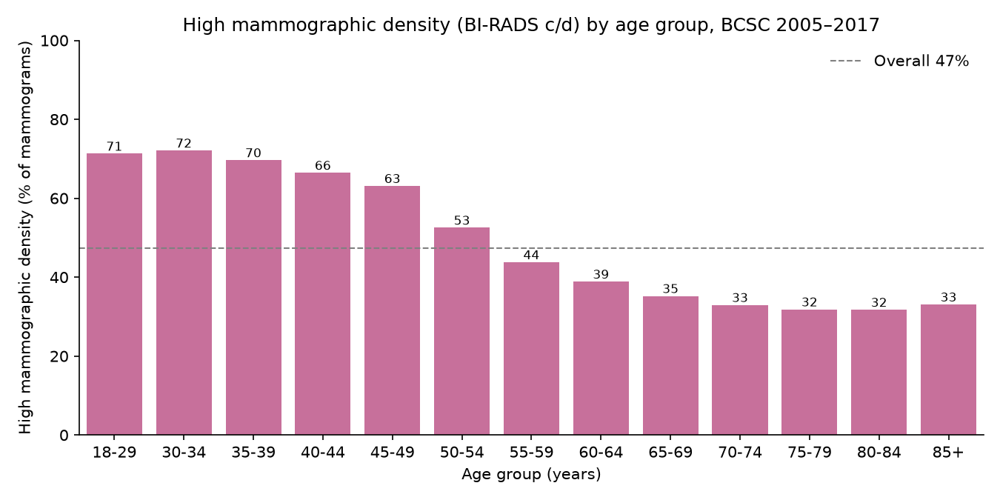
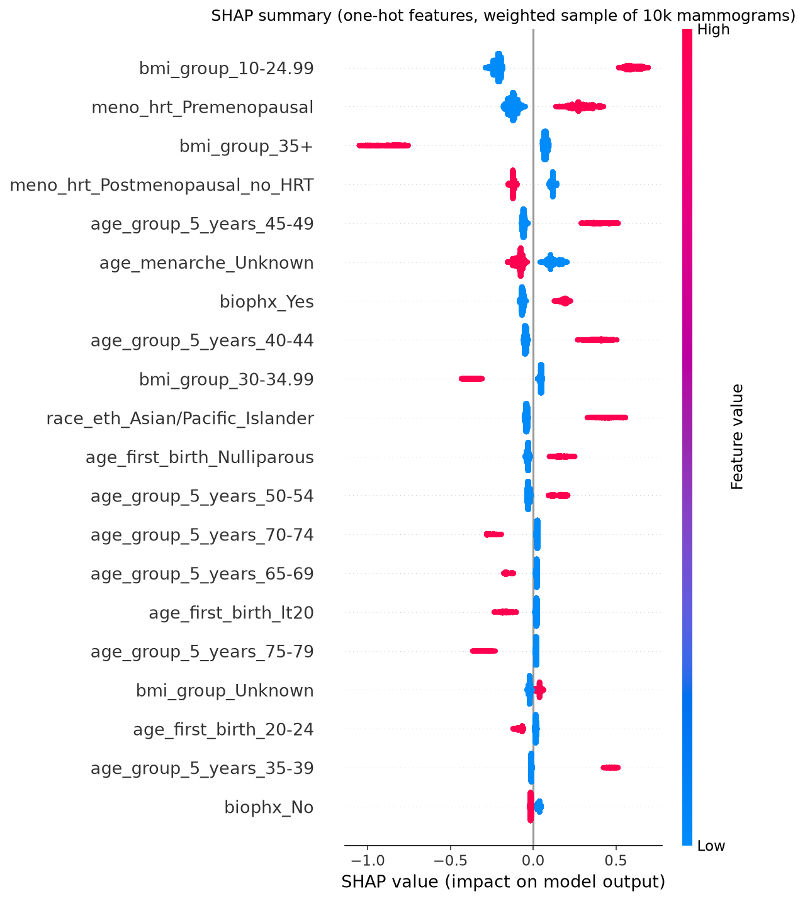

# High Mammographic Density in the BCSC Risk Factors Data (Python)

**Question:** How common is high mammographic density in US screening mammograms, which risk factors are linked to it, and how well can it be predicted from those factors alone?

## Data
[Breast Cancer Surveillance Consortium (BCSC) Risk Factors dataset](https://www.bcsc-research.org/datasets/rf/documentation), summarized version, 09/2020 release: 6,788,436 screening mammograms from 2005 to 2017, aggregated into 1,522,340 risk-factor patterns. 6,028,759 mammograms have a known BI-RADS density.

**The data is not included in this repository.** To reproduce the analysis:
1. Download the three files `bcsc_risk_factors_summarized{1,2,3}_092020.csv` from the BCSC Risk Factors dataset page (link above), accepting the BCSC data use terms.
2. Put them in `data/raw/`. The whole `data/` folder is git-ignored.

## Method
- **Target:** high mammographic density = BI-RADS c or d (heterogeneously or extremely dense tissue), stored as `high_density`.
- **Cleaning** (`src/clean.py`): verified totals, mapped code 9 to "unknown" (except in the age variable, where 9 means ages 65 to 69), and added readable labels.
- **Preparation** (`src/prepare.py`): one-hot encoding, menopause and hormone therapy combined into one variable, missing values kept as their own category, stratified 80/20 split. Each row is weighted by its mammogram count.
- **Models** (`notebooks/02_modeling.ipynb`): weighted logistic regression (adjusted odds ratios) and XGBoost with 5-fold CV and SHAP explanations. Evaluated on held-out data with ROC AUC, PR AUC, Brier score and calibration.
- **Deep dives** (`notebooks/04_deep_dives.ipynb`): raw vs adjusted effects, fairness and calibration by group, family history strata, what-if profiles.

## Findings
1. **High density is common:** 47.3% of screening mammograms are rated BI-RADS c or d.
2. **It declines with age:** 71 to 72% at ages 18 to 34, 53% at 50 to 54, and about 32% from age 70.
3. **BMI is the strongest predictor:** 66% high density at BMI under 25 vs 22% at BMI 35+ (adjusted OR 0.14). BMI also ranks first in SHAP importance.
4. **Hormone therapy after menopause is linked to higher density:** 49.1% vs 38.1% without (adjusted OR 1.34).
5. **Asian/Pacific Islander women have the highest share:** 65.1% vs 46.5% for non-Hispanic white women (adjusted OR 1.71).
6. **Family history barely matters:** 47.1% vs 47.4% (OR 1.08). Having no children (OR 1.46) and a previous biopsy (OR 1.44) matter more.
7. **Risk factors only partly predict density:** ROC AUC 0.72 for both models (PR AUC 0.70 vs 0.47 no-skill), and both are well calibrated. XGBoost does not beat logistic regression, so the factors mostly add up rather than interact. Only the mammogram itself shows the tissue density.




Full findings and limitations are in [`reports/findings.md`](reports/findings.md). The main limitations: the data are aggregated mammograms rather than individual women (the same woman can appear in several years), missingness is high for some variables, and all results are associations, not causal effects.

## Run
```bash
python3 -m venv .venv && source .venv/bin/activate
pip install -r requirements.txt
python src/clean.py
python src/prepare.py
jupyter lab notebooks/   # run 01_eda, 02_modeling, 04_deep_dives in order; plots go to output/
python src/linkedin_figures.py   # optional: summary carousel in output/linkedin/
```
